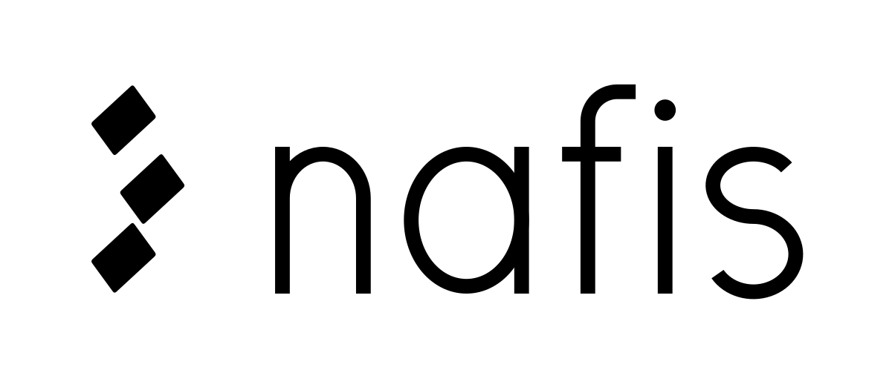

<p align="center">
  
</p>

# Nafis

A product-design council for coding agents. Three lenses question a planned or
existing design the way a product manager and a senior product designer would, and
their findings merge into one verdict.

| Lens | Question | Looks at |
|---|---|---|
| **Cooper** | Who is this for, and for which goal? | the user and their situation, the goal, scope, defaults, contracts, the success and kill metrics |
| **Tesler** | Who carries the complexity? | flow, steps, decisions, inputs, defaults, failure handling, module depth |
| **Norman** | Can a person use this correctly without help? | what is seen first, signifiers, feedback, states, copy, errors, names, logs |

The council diagnoses and never edits on its own judgement: fixes go through your
skills or are applied from each finding's Move, and product decisions come to you. It
works on `ui` and `backend` targets alike; in backend work "the user" is three people:
the end user, the caller and the operator.

Its knowledge is 114 short cards (laws, principles and patterns from usability,
product and systems design), each a critical question with the smell to hunt and the
move to make. The cards name no framework, vendor or project. Everything specific to
your project lives in a profile you open.

**No required dependencies.** Nafis runs on its own cards. Helper skills are optional
integrations it uses when they are installed.

## Install

1. **Any agent** (Claude Code, Codex, Cursor, Gemini CLI and others):

   ```sh
   npx skills add dasturchioka/nafis
   ```

   Add `-g` for all projects and `-a '*'` for every installed agent.

2. **Claude Code plugin:**

   ```
   /plugin marketplace add dasturchioka/nafis
   /plugin install nafis@dasturchioka
   ```

3. **Manual:** clone the repo and symlink `skills/nafis` into the agent's skills
   folder, for example:

   ```sh
   git clone https://github.com/dasturchioka/nafis.git ~/src/nafis
   ln -s ~/src/nafis/skills/nafis ~/.claude/skills/nafis
   ```

Pick one install path per machine (skills CLI, plugin, or symlink): with two installs,
which one a bare `/nafis` opens is undocumented.

Then open a profile in your project:

```
/nafis profile new
```

On a plugin install, if another `/nafis` command already exists, use the full form
`/nafis:nafis`. In an agent without slash commands, ask for "nafis profile new".

### Optional helper skills

None of these is required. When one is installed (and allowed by your profile), Nafis
uses it for that step; otherwise it does the step itself.

| Skill set | Used for |
|---|---|
| [impeccable](https://github.com/pbakaus/impeccable) | shaping a UI brief; critique and audit evidence; distill, onboard, harden, clarify, layout and typeset fixes |
| [Emil Kowalski's skills](https://github.com/emilkowalski/skills) (`break-ui`, `mobile-native`, `review-animations`, `emil-design-eng`) | worst-case data, phone feel and motion evidence; final polish |
| [Matt Pocock's skills](https://github.com/mattpocock/skills) (`grilling`, `grill-with-docs`, `domain-modeling`, `to-spec`, `to-questionnaire`, `wayfinder`, `prototype`, `codebase-design`, `improve-codebase-architecture`, `tdd`, `code-review`, `diagnosing-bugs`) | interviews, glossary, specs, prototypes, architecture and test-first fixes, standards review |

The full route → skill table is in `skills/nafis/references/routes.md`.

## Commands

| Command | What happens |
|---|---|
| `/nafis profile new` | Opens a profile for the current project, with you: Nafis discovers what it can, asks what only you know, and writes it after your approval. |
| `/nafis plan <feature>` | Turns a TZ, idea or brief into the feature's `brief.md`: Cooper's job, user, scope line, no-gos and metrics; Tesler's flow and defaults; Norman's states and feedback. |
| `/nafis review [target]` | Judges a screen, PR, branch diff, screenshot or message and gives one verdict. With no target, the current branch's changes. |
| `/nafis cooper\|tesler\|norman [plan\|review] <target>` | One lens only. |

## How a run goes

- **Who runs depends on the size of the work.** Copy, colour or one control: Norman
  in quick mode, or nobody. Improving an existing screen or an internal module:
  Tesler and Norman. A new screen, flow, feature or surface (endpoint, webhook,
  config, schema): all three.
- **Cooper goes first, as the gate.** If he finds the work serves no one's goal, the
  run stops and asks you. Then Tesler and Norman run in parallel (as subagents where
  the agent supports them, otherwise one after another).
- **Every finding carries evidence** (a screenshot, `file:line`, or data), at most
  five per lens, no generic advice.
- **One verdict.** Severity first; on a tie Cooper > Tesler > Norman.

| Severity | Means | Verdict |
|---|---|---|
| `shit` | the user cannot finish, loses data, or does the wrong thing (money, messages to customers); backend: data lost, money wrong, silent failure, broken contract | ⛔ stop |
| `bad` | the user finishes but struggles, makes mistakes or writes to support; backend: hidden rules, duplicated rules, unclear errors | ⚠️ fix |
| `nice` | polish only | ✅ pass |

After the verdict, ⚠️ findings are fixed (through a helper skill or directly from the
finding's Move) and re-checked; ⛔ findings, Cooper's cut list and the optional polish
batch come to you in one message.

## Profiles and features

Profiles live outside every repo, in `~/.council/<profile>/`:

```
~/.council/<profile>/
  profile.md              users and roles, locales, channels, widths and themes,
                          data sources and house rules, repo rules file,
                          path → target map, optional helper allowlist
  features/<slug>/
    brief.md              written by plan; the promises a review checks
    reviews.md            appended by every review, with your decision on each finding
```

Nafis picks the profile whose `paths` contain the working directory. Without one it
stops and asks you to open one; it never creates a profile on its own. The repo's own
agent-rules file, named in the profile, always wins over a card.

**Data.** Reading has no default limits: the lenses read the sources your profile names
and any others that help. Your profile's house rules decide what may be quoted in
chat. Real customer data never goes into Nafis's files; extremes are recorded by their
shape with synthetic values.

## Repository layout

```
.claude-plugin/          plugin and marketplace manifests
skills/nafis/
  SKILL.md               the router
  agents/                role prompts: cooper.md, tesler.md, norman.md
  references/
    council.md           shared contract: rules, evidence, severity, report formats
    plan.md, review.md, profile-new.md, routes.md
    cards/               114 cards, split by lens and target
    templates/           profile.md, brief.md, reviews.md
assets/                  the logo
docs/maintaining.md      card admission rule, split map and provenance
```

## The name

*Nafis* means refined or exquisite. It comes from Alisher Navoi's *Majolis un-nafois*
(1491), a critical anthology that judged nearly 460 poets. The mark, *Nuqta*, is three
calligraphy dots set at the reed-pen slant: calligraphers measure a letter in these
dots, so the three dots read as three questions, the measure the work must reach.

## License

MIT. See [LICENSE](LICENSE).
